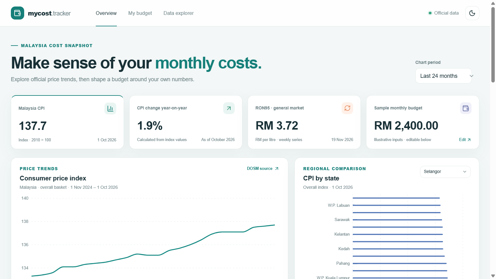

# MyCost Tracker

**MyCost Tracker is a student-focused dashboard for exploring how selected Malaysian consumer prices have changed, using official data.gov.my datasets.** It is an original, standalone Next.js App Router project. It includes a locally saved, editable example budget and does not collect accounts or send budget entries to a server.

This is a new project: it has no published user, download, or adoption metrics. It is not deployed yet; the Vercel instructions below are for a future deployment.

## Features

- National CPI trend, state CPI comparison, and weekly fuel-price charts.
- Date-window and state/dataset controls, plus light/dark theme.
- Searchable dataset explorer with table/chart views and CSV export.
- Editable monthly budget saved in the current browser.
- Typed official-data access with response validation, caching, retries, rate limiting, stale fallback, and visible error states.
- Two pandas notebooks for documented CPI and fuel-price analysis.

## Screenshots and live demo

- **Live demo:** not deployed. After deploying this repository with its root directory as the Vercel project root, replace this line with the real deployment URL.
- **Dashboard screenshot:** captured from the running app on 23 November 2026; data shown is a point-in-time view and will change as upstream data updates.



- **Mobile screenshot:** placeholder; no mobile screenshot is checked in yet. Capture a real mobile-width rendering and add it as `docs/screenshots/dashboard-mobile.png`.

The mobile screenshot remains a placeholder, and the dashboard image is not evidence that the app is publicly hosted. Browser-based visual validation was also performed during development.

## Run locally

Requirements: Node.js 22 or newer and npm.

```powershell
npm ci
npm run dev
```

Open `http://localhost:3000`. The app needs internet access to retrieve source data. No API token or environment variable is required. Other commands:

```powershell
npm run lint
npm run typecheck
npm test
npm run build
npm start
```

## Dashboard and calculations

- **CPI trend:** Malaysia's overall consumer price index, with 12-month, 24-month, and five-year display windows. The index is based on 2010 = 100 and measures a representative basket, not an individual's personal inflation.
- **State comparison:** latest available overall CPI index for each state/territory, with the selected state highlighted. Values are index values, not RM costs.
- **Fuel prices:** official weekly level series for general-market RON95, RON97, and Peninsular Malaysia diesel, in RM per litre. The explorer includes the available East Malaysia and subsidized RON95 fields. Eligibility and geographic coverage matter; charted general-market values are not a price quote for every user.
- **Year-on-year CPI change:** `(current month's index / same month's index one year earlier - 1) × 100`. It is shown only when both official observations are present.
- **Budget scenario:** editable sample category inputs total RM2,400 per month by default: Housing RM1,200, Food RM650, Transport RM250, Utilities RM180, and Other RM120. These are demonstration assumptions, not official or representative household expenditure statistics. Users can change, add, or remove categories; entries stay in browser storage.
- **One-year planning estimate:** `monthly input total × (1 + latest national year-on-year CPI change / 100)`. The calculation assumes the latest CPI change repeats for the next 12 months and does not model a user's spending mix. It is illustrative, not a forecast or financial advice.

The dataset explorer shows up to 100 recent records for the selected dataset, filters those returned rows locally, and exports the visible rows to CSV. The dashboard identifies source release dates, refresh frequency, and stale in-process fallback data where applicable.

## Verified official datasets

The following IDs, fields, coverage dates, and example values were confirmed using successful HTTP 200 requests to the official API on 23 November 2026. Data releases can change; the app displays the live response metadata rather than treating these examples as static values.

| Dataset ID / API | Verified fields used | Confirmed coverage | Live endpoint comparison |
| --- | --- | --- | --- |
| `cpi_headline` — [OpenDOSM CPI page](https://open.dosm.gov.my/data-catalogue/cpi_headline), [OpenDOSM API](https://api.data.gov.my/opendosm?id=cpi_headline) | `date`, `index`, `division` | 1980-01-01–2026-10-01 | Latest `overall` record: index 137.7 on 2026-10-01; base 2010 = 100. |
| `cpi_state` — [OpenDOSM state CPI page](https://open.dosm.gov.my/data-catalogue/cpi_state), [OpenDOSM API](https://api.data.gov.my/opendosm?id=cpi_state) | `date`, `index`, `state`, `division` | 2010-01-01–2026-10-01 | Latest `overall` observations include Selangor 144.7 and Johor 142.6 for October 2026. |
| `fuelprice` — [Data Catalogue fuel-price page](https://data.gov.my/data-catalogue/fuelprice), [Data Catalogue API](https://api.data.gov.my/data-catalogue?id=fuelprice) | `date`, `series_type`, `ron95`, `ron97`, `diesel`, `diesel_eastmsia`, `ron95_budi95`, `ron95_skps`, `diesel_budi`, `diesel_skds` | 2017-03-30–2026-11-19 | Latest `level` observation: RON95 RM3.72/L, RON97 RM4.00/L, Peninsular diesel RM4.72/L on 2026-11-19. The live latest-record response also included `diesel_budi` and `diesel_skds`. |

Coverage dates were checked with `sort=date&limit=1` and `sort=-date&limit=1`; current comparisons used `sort=-date` and an `overall@division` filter for CPI. The sources identify DOSM for CPI and the Ministry of Finance for fuel prices. Dataset pages describe CPI as monthly and fuel prices as weekly and define the fields and units above.

The displayed 1.9% CPI change is independently reproducible from the official `cpi_headline` response: October 2025 index 135.1 and October 2026 index 137.7 give `(137.7 / 135.1 - 1) × 100 = 1.9245%`, rounded to 1.9%. [Exact official query](https://api.data.gov.my/opendosm?id=cpi_headline&filter=overall%40division&date_start=2025-10-01%40date&date_end=2026-10-01%40date&sort=date&limit=24&meta=true).

### API use, caching, and errors

- The [official quickstart](https://developer.data.gov.my/quickstart.en) states the API needs no token. The [rate-limit documentation](https://developer.data.gov.my/rate-limit.en) sets 4 requests/minute for each API family. Query parameters and response envelopes are documented in the [request guide](https://developer.data.gov.my/request-query) and [response guide](https://developer.data.gov.my/response-format).
- The server uses Next.js fetch caching for one hour, retries transient HTTP 429/5xx and network failures up to three attempts, and limits each API family to four requests in a rolling minute per running server process.
- If an API request fails after a successful request in the same process, the last successful response is served with a stale marker. Otherwise the affected chart or explorer shows an error rather than fabricated values. Next/Vercel cache behavior may additionally serve a prior successful fetch during revalidation.
- Process-local limiting is best effort on Vercel: separate serverless instances do not share the in-memory request window or fallback. The upstream API remains rate-limited; high-volume deployments need a shared cache/rate limiter.

### Data license and attribution

The official CPI and fuel-price dataset pages state that the data is available under the [Creative Commons Attribution 4.0 International License (CC BY 4.0)](https://creativecommons.org/licenses/by/4.0/). Attribution in the app names the Department of Statistics Malaysia (DOSM) and Ministry of Finance (MOF) and links to the dataset pages. Repository code is licensed under MIT; see [`LICENSE`](LICENSE). The upstream data's CC BY 4.0 terms remain separate.

Direct application dependencies use permissive MIT, ISC, or Apache-2.0 licenses (checked from the installed package metadata).

## Limitations

- The budget categories and amounts are editable illustrative assumptions, not official or representative expenditure statistics, forecasts, or financial advice.
- CPI describes a representative basket and is not an individual's personal inflation rate.
- Dataset freshness and coverage depend on the upstream data.gov.my services. When a source is unavailable and there is no successful in-process response to reuse, the app shows an error rather than synthesizing data.
- The in-memory rate limiter and fallback are per server process. They are best-effort on multi-instance/serverless deployments and do not coordinate across instances.
- The app has not been deployed publicly. The checked-in desktop screenshot is a development capture, not a live deployment; no user research results are claimed for this tracker.

## Notebooks

Two Jupyter notebooks use pandas and query the same official endpoints:

- [`notebooks/01-cpi-trends.ipynb`](notebooks/01-cpi-trends.ipynb) retrieves and calculates monthly national CPI trends.
- [`notebooks/02-state-and-fuel-prices.ipynb`](notebooks/02-state-and-fuel-prices.ipynb) compares state CPI indices and plots weekly fuel-price series.

Install notebook dependencies in a Python environment with `pip install pandas requests matplotlib`. Notebook requests are subject to the same API rate limits. Outputs are not embedded so each run reflects the live data available at that time.

## CI and Vercel deployment

The GitHub Actions workflow at `.github/workflows/ci.yml` runs install, lint, typecheck, tests, and a production build on every push and pull request.

For Vercel, import the repository and use its root directory. The included `vercel.json` selects the Next.js framework, `npm ci`, and `npm run build`. No secrets or API keys are needed.

## Roadmap

Potential follow-up work (not yet implemented):

- Capture and add a real mobile-width screenshot; the current desktop screenshot is already checked in.
- Improve keyboard and screen-reader access for chart data with equivalent text/table summaries.
- Add integration coverage for API timeout, rate-limit, and stale-fallback scenarios.
- Publish the documented starter issues if desired.

Suggested GitHub topics: `malaysia`, `open-data`, `nextjs`, `typescript`, `dashboard`, `data-visualization`.
